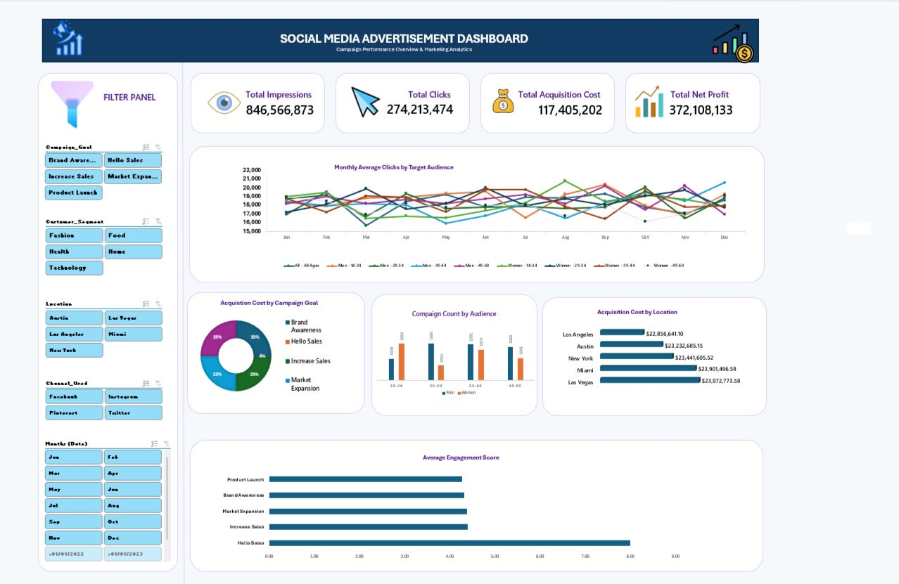

# Social Media Advertisement Analytics (Excel)

Analysis of 15,001 social media ad campaigns from 2022 across Facebook, Instagram, Twitter, and Pinterest. Built in Microsoft Excel using Power Query, PivotTables, and slicers to track campaign ROI, customer acquisition costs, and audience engagement.

## Business Objective
Evaluate 2022 ad performance across four social media platforms and five US cities (Las Vegas, Miami, New York, Austin, Los Angeles) to answer three questions:
* Which platforms and campaign goals generate the highest net profit and engagement?
* How is acquisition spend distributed across cities and campaign objectives?
* How do monthly click trends vary by gender and age group?

## Data Cleaning & Preparation
* **Validation:** Checked 15,001 campaign rows for missing values and duplicate entries.
* **Column Splitting:** Split `Target_Audience` into separate `GENDER` and `Age_Group` columns.
* **Text Formatting:** Removed `*` and `$` characters from `Campaign_Goal`, stripped `" Days"` from `Duration` to make it numeric, and removed newline characters from `ROI`.
* **New Metrics:**
  * `Net Profit` = `ROI * Acquisition_Cost`
  * `Click Per Day` = `Clicks / Duration`

## Key Findings

### 2022 Overall Metrics
| Metric | Total / Average |
| :--- | :--- |
| Total Impressions | 846,566,873 |
| Total Clicks | 274,213,474 |
| Total Acquisition Cost | $117,405,201.93 |
| Total Net Profit | $372,108,132.80 |
| Average ROI | 3.19 |
| Average Conversion Rate | 8.01% |

### Channel Breakdown
| Channel | Impressions | Clicks | Acquisition Cost | Net Profit |
| :--- | :--- | :--- | :--- | :--- |
| Instagram | 231,410,319 | 76,188,070 | $29,174,631.41 | $117,407,274.26 |
| Facebook | 230,838,322 | 76,030,344 | $29,113,836.94 | $117,074,173.32 |
| Twitter | 230,476,391 | 75,883,503 | $29,068,353.49 | $116,139,296.46 |
| Pinterest | 153,841,841 | 46,111,557 | $30,048,380.09 | $21,487,388.76 |

* **Channel Takeaway:** Instagram, Facebook, and Twitter each generated ~$116M–$117M in net profit on ~$29.1M spend. Pinterest had the highest acquisition cost ($30.05M) while producing only $21.49M in net profit. Reallocating budget from underperforming Pinterest campaigns to Instagram and Facebook would increase overall ROI.
* **Campaign Goals:** Brand Awareness had the highest spend ($29.87M across 3,791 campaigns). Excluding a single outlier record (`Hello Sales`, score 8.0), Increase Sales had the highest average engagement score (4.40) and Product Launch had the lowest (4.27).
* **Locations & Audience:** Spend was evenly distributed across Las Vegas ($23.97M), Miami ($23.90M), New York ($23.44M), Austin ($23.23M), and Los Angeles ($22.86M). Excluding `All Ages` (1,672 campaigns), targeting was balanced between Men (6,707) and Women (6,622), led by `Men 25-34` (1,695) and `Women 18-24` (1,694).

## Repository Files
* `Social_Media_Analytics_Dashboard.xlsx` — Excel workbook containing raw data, cleaned data, PivotTables, and interactive dashboard.
* `dashboard_overview.jpeg` — Dashboard screenshot.
